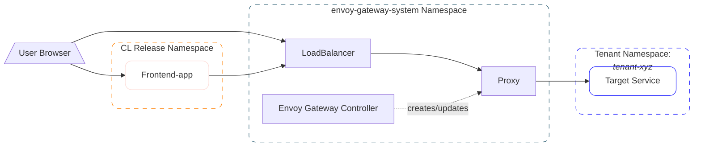
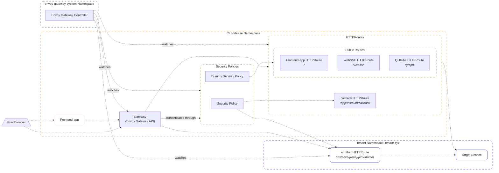

# Gateway API - Architecture and Routing

CrownLabs uses [*Envoy Gateway*](https://gateway.envoyproxy.io/) implementing the Kubernetes Gateway API (`gateway.networking.k8s.io/v1`) to manage L7 traffic routing, domain unification, and access security policies for all cluster services and user environments.

## Architecture & Gateway Choice Rationale

CrownLabs originally relied on a legacy NGINX Ingress Controller setup using custom annotations for L7 ingress routing.

During the transition to the Kubernetes Gateway API, an implementation based on **Cilium** was evaluated following an initial Proof of Concept (PoC). While Cilium offers efficient eBPF-based kernel networking, testing revealed critical L7 policy limitations:
* **Lack of `SecurityPolicy` Resource Support**: When native Kubernetes `SecurityPolicy` custom resources were applied, Cilium did not support or recognize them at all, forcing access control rules to rely on fragmented annotation-based workarounds.
* **Focused Ingress vs CNI Scope**: Cilium's Gateway API controller is tightly coupled with its CNI networking engine rather than acting as a dedicated, pure application-level proxy controller.

To achieve a clean, maintainable, and standards-compliant architecture, CrownLabs selected **Envoy Gateway**, which provides the following key advantages:
* **Native `SecurityPolicy` Support**: Full native recognition and processing of `SecurityPolicy` custom resources, enabling a clean two-level security policy model (Global Gateway policy + per-route overrides).
* **CNCF Reference Standard**: As the official CNCF reference controller for the Kubernetes Gateway API project, it adheres strictly to upstream standards without vendor lock-in or proprietary CRD extensions.
* **High Performance & Low Latency**: Powered directly by Envoy Proxy (the industry-standard C++ data plane), providing high request throughput, low latency, and efficient memory usage.
* **Decoupled Control & Data Plane**: Clear architectural separation between the Gateway Controller (control plane) and the Envoy Proxy fleet (data plane), enabling independent horizontal scaling.
* **Native Policy Extensibility & Authentication**: First-class support for authentication policies (OIDC), TLS termination, and advanced L7 traffic management (URL rewriting, path prefix matching, timeouts) without custom annotation friction or service mesh operational overhead.

## Architecture

The gateway architecture separates the control plane from the data plane:
* **Gateway Controller**: Reconciles `Gateway`, `HTTPRoute`, and `SecurityPolicy` resources, programming the underlying proxy configuration.
* **Envoy Proxy**: Data plane proxies dispatching incoming HTTPS traffic to target services.

The following diagrams describe the same Gateway architecture from two complementary
perspectives. The **data plane flow** shows how requests travel through the deployed
data-plane components: users and the frontend reach the Envoy load balancer, which
forwards traffic through the Envoy proxy to the target service. The **control plane and
routing flow** shows how the Kubernetes Gateway API resources work together: the Gateway
routes requests to the appropriate HTTPRoutes, applies the configured Security Policies,
and is continuously reconciled by the Envoy Gateway Controller, which watches these
resources and updates the proxy configuration.

Solid arrows represent data-plane request or forwarding paths, while dashed arrows
represent control-plane and routing relationships.

### Data Plane Flow

### Control Plane and Routing Flow

### Single Global Gateway Model

CrownLabs adopts a **single global Gateway architecture** (`Crownlabs main`, class `envoy-public`) as the sole public entrypoint for the entire platform. The rationale behind this design includes:
* **Centralized Ingress Management**: Concentrates L7 traffic routing, domain unification, TLS certificate management, and global security policies under a single unified entrypoint.
* **Safe Multi-Tenancy via Route Selectors**: Rather than deploying separate gateway instances for different workspaces or tenants, a single shared Gateway safely serves all static core services and dynamic per-user instances by restricting route attachment using namespace label selectors.

## Deployment & Configuration Model

Core Gateway API resources are declared in the main CrownLabs Helm chart (`deploy/crownlabs/`).

To ensure architectural consistency, non-changing properties are hardcoded within the resource template (`deploy/crownlabs/templates/gateway-api.yaml`), while deployment-specific properties are configured via `deploy/crownlabs/values.yaml`.

*(Note: For detailed Gateway API control flags, authentication mechanics, and namespace security configuration, please refer to the [Authentication and Centralized Gateway](authentication-and-gateway.md) document).*

## Domain Unification and Path Routing

CrownLabs consolidates all core web services under a single primary domain (e.g., `crownlabs.polito.it`) using path-prefix matching on `HTTPRoute` resources:

| Service | Sub-chart | Path Prefix | Description |
| :--- | :--- | :--- | :--- |
| **Frontend** | `frontend-app` | `/` | CrownLabs Dashboard UI |
| **QL Cube** | `qlkube` | `/graph` | GraphQL API |
| **Web SSH** | `bastion` | `/webssh` | Command-line Web SSH interface |

Per-user VM and container instances generated by the Instance Operator receive dynamic `HTTPRoute` resources appended under unique instance path prefixes.

## Route Logic Optimization

### Timeouts
Two separate timeout values are configured to prevent resource hangs:
* **Static Routes (e.g. WebSSH, QLKube, Frontend)**: Both `request` (maximum time for the gateway to process the request) and `backend request` (time the gateway waits for the backend service to respond) timeouts are set to **600 seconds** via Helm values.
* **Dynamic Routes (e.g. Interactive Virtual Machine Sessions)**: For dynamic routes (like the ones for interactive virtual machine sessions), the timeout is set to **3600 seconds** (1 hour).

### URL Rewriting vs. Redirect
When cleaning up request paths before forwarding them to user backends, CrownLabs implements **Prefix URL Rewriting** instead of a Redirect logic. This relies on a strict routing schema (e.g., `https://<domain>/app/instance/<tenant-name>/<instance-name>/<environment-name>/`).
* **Mechanism**: The Gateway API `URLRewrite` filter intercepts traffic matching the instance-specific path prefix (which acts as the fundamental routing contract). It strips this entire prefix and replaces it with an empty string (`""`), passing only the trailing path (e.g. `/ssh`) to the backend service. Any divergence from this schema will result in an HTTP 404 error because the route won't match.
* **Rationale**: Using Rewrite instead of Redirects is faster and executes entirely in the Envoy data plane, saving client round-trips. It also abstracts away the complex path structures from the underlying user environments, which can simply serve their content from the root `/` path.
* **Path Management**: Under the legacy Ingress architecture, path stripping was managed via regex matching and the `rewrite-target` annotation. The Gateway API replaces this fragile parsing with a clean, native prefix replacement filter defined directly in the `HTTPRoute`.

### Legacy Annotations Obsolescence
Under Gateway API mode, `HTTPRoute` resources **do not inherit or use any legacy NGINX Ingress annotations**. The previous annotation-based configurations have been entirely replaced by native mechanisms:
* **Timeouts (WebSSH/Instances)**: Migrated to the native `timeouts` block inside the `HTTPRoute` specification.
* **TLS & Cert-Manager (Frontend)**: The `cert-manager.io/cluster-issuer` annotation is no longer needed on individual routes. TLS termination and certificate management are now handled centrally on the global `Gateway` resource.
* **Buffer Sizes**: Obsolete. Envoy natively accommodates much larger headers (e.g., up to 60K for request headers) without requiring manual tuning of memory chunks, thus removing the need for `proxy-buffer-size` annotations.
* **Custom HTTP Errors**: Obsolete. Envoy manages error flows directly. While NGINX required the `custom-http-errors` annotation (e.g. for error 418), under Gateway API this custom logic is no longer implemented at the route level. (If needed in the future, it can be handled via `EnvoyPatchPolicy`).

### WebSockets Support
In Gateway API v1.3, WebSocket integration is greatly simplified. Instead of using custom proxy annotations to upgrade connections, administrators define `App Protocol` as `"kubernetes.io/ws"` directly on the Service port definition. The Envoy proxy automatically detects this protocol and upgrades connections natively.

### Buffer Size & Large Headers
The legacy NGINX Ingress constraint of a 4K/8K buffer size is obsolete under Envoy. NGINX traditionally uses fixed-size memory chunks to parse response headers, requiring administrators to manually tune annotations like `proxy-buffer-size` to prevent 502 Bad Gateway errors when dealing with large headers.
Envoy natively accommodates much larger headers (by default up to 60K) without requiring manual tuning of memory chunks, thus making legacy buffer tuning annotations entirely unnecessary.

---

## Legacy Ingress Annotations to Gateway API Mapping

The following table summarizes how legacy NGINX Ingress annotations are mapped to native Gateway API specs or Envoy mechanisms within CrownLabs:

| Legacy Ingress Annotation | Gateway API / Envoy Native Equivalent | Description |
| :--- | :--- | :--- |
| `nginx.ingress.kubernetes.io/proxy-read-timeout` / `proxy-send-timeout` | `HTTPRoute.spec.rules[].timeouts.backendRequest` | Configured to 600s for static routes (3600s for VM sessions) |
| `nginx.ingress.kubernetes.io/proxy-connect-timeout` | `HTTPRoute.spec.rules[].timeouts.request` | Configured to 600s for static routes (3600s for VM sessions) |
| `nginx.ingress.kubernetes.io/rewrite-target` | `HTTPRoute.spec.rules[].filters` (Type: `URLRewrite`) | Replaces matched prefix path with `""` |
| `nginx.ingress.kubernetes.io/websocket-services` | Service Port `appProtocol: kubernetes.io/ws` | Gateway API 1.3 native WebSocket upgrade |
| `nginx.ingress.kubernetes.io/proxy-buffer-size` | Native Envoy Stream Handling | Obsolete. Envoy natively supports headers/streams up to 60K |
| `nginx.ingress.kubernetes.io/custom-http-errors` | Native Envoy Error Flows | Obsolete. Envoy manages errors directly; custom logic can be patched via Envoy Patch Policy if needed in the future |
